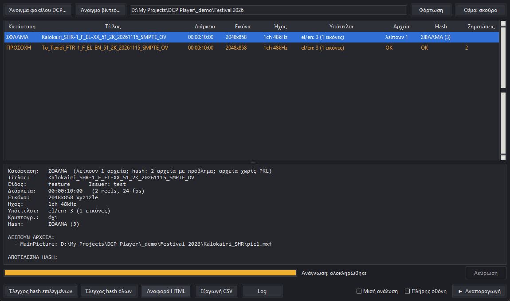
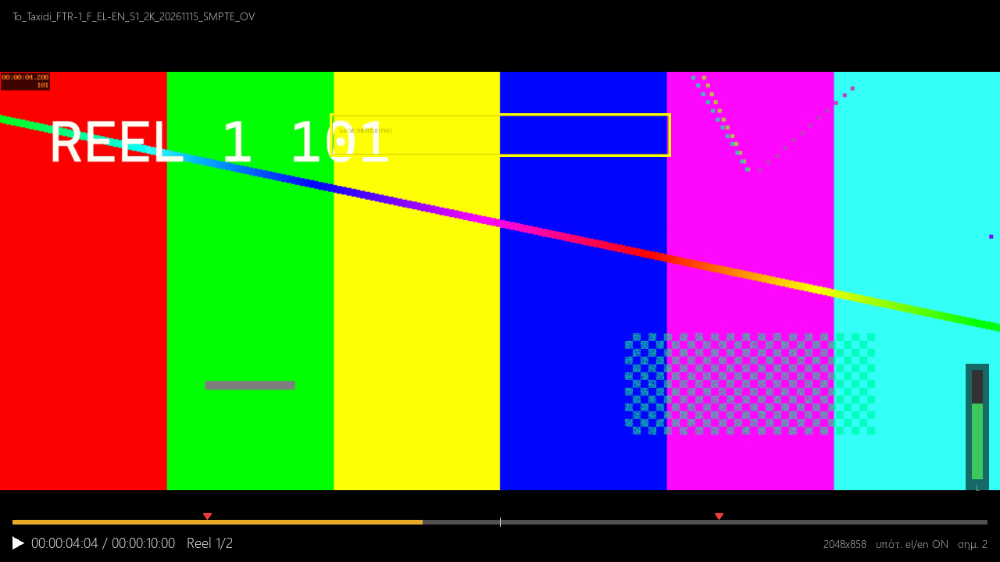

# ReelCheck

Απλός, ερασιτεχνικός player για **έλεγχο DCP ταινιών** (Digital Cinema Package) σε κανονικό PC με Windows.
Φτιάχτηκε για να ελέγχουμε τις ταινίες που στέλνουν στο φεστιβάλ: παίζουν σωστά, έχουν όλα τα αρχεία,
δεν χάλασαν στη μεταφορά, έχουν ήχο και υπότιτλους.

> Δεν είναι εργαλείο προβολής σε αίθουσα ούτε color grading. Τα χρώματα είναι προσεγγιστικά (XYZ → RGB).

## Screenshots

| Φωτεινό θέμα | Σκούρο θέμα |
|---|---|
|  |  |

| Αναπαραγωγή με υπότιτλους και σημειώσεις | Υπότιτλος-εικόνα (PNG) |
|---|---|
|  |  |

| Μετρητές καναλιών ήχου 5.1 |
|---|
|  |

*Τα screenshots είναι από δοκιμαστικά DCP με μοτίβο ελέγχου.*

## Δυνατότητες

- **Αναπαραγωγή DCP** (Interop και SMPTE, JPEG2000, 2K/4K, 24/25/30/48 fps), με συγχρονισμένο ήχο
- **Υπότιτλοι**: κειμένου (Interop XML, SMPTE MXF), εικόνας (PNG), closed captions, και αλλαγή γλώσσας
  από άλλο CPL του ίδιου φακέλου (VF)
- **Έλεγχος ακεραιότητας (hash)**: σύγκριση κάθε αρχείου με το PKL (μέγεθος + SHA-1)
- **Μαζικός έλεγχος**: δίνεις φάκελο με πολλά DCP και βλέπεις όλα τα CPL σε πίνακα με κατάσταση OK / ΠΡΟΣΟΧΗ / ΣΦΑΛΜΑ
- **VF με OV**: ένα Version File (π.χ. μόνο υπότιτλοι) που παίρνει εικόνα και ήχο από το OV του βρίσκει μόνο του
  τα αρχεία στο OV του ίδιου φακέλου («Αρχεία: OK (+OV)»), παίζει κανονικά και ελέγχεται με το PKL του OV
- **Αναφορά HTML** (με καρέ από κάθε ταινία, hash και σημειώσεις, εκτυπώνεται και σε PDF) και **CSV για Excel**
- **Κανάλια ήχου**: μετρητές στάθμης ανά κανάλι και solo σε L / R / C / LFE / Ls / Rs ...
  Οι μετρητές μπορούν να φαίνονται μόνο με τα χειριστήρια, πάντα ή καθόλου (πλήκτρο `A`)
- **Έλεγχος του ονόματος (DCNC)**: διαβάζει από το όνομα του DCP είδος, γλώσσα ήχου/υποτίτλων, ήχο (5.1, 7.1),
  2K/4K, aspect, fps, SMPTE/Interop, OV/VF, και δείχνει όταν το όνομα δεν ταιριάζει με το περιεχόμενο
  (π.χ. γράφει 5.1 αλλά ο ήχος είναι στέρεο, γράφει EN αλλά δεν έχει αγγλικούς υπότιτλους)
- **Προδιαγραφές φεστιβάλ**: ορίζεις μία φορά τι δέχεστε (2K/4K, fps, SMPTE/Interop, ήχος, γλώσσα υποτίτλων,
  μέγιστη διάρκεια, όχι κρυπτογραφημένα / 3D) και ό,τι δεν ταιριάζει παίρνει ΠΡΟΣΟΧΗ
- **Σάρωση ταινίας χωρίς προβολή**: μαύρη εικόνα, σιωπή, κανάλια χωρίς σήμα, clipping, μέγιστη και μέση στάθμη,
  ήχος διαφορετικής διάρκειας από την εικόνα, υπότιτλοι εκτός διάρκειας (περίπου 3 λεπτά για ταινία 2 ωρών)
- **Αλλαγή ήχου** στην αναπαραγωγή (`U`) από άλλο CPL ίδιας διάρκειας (π.χ. VF με άλλη γλώσσα)
- **Λίστα προβολής**: τρέιλερ / σποτ πρώτα και μετά η ταινία, η μία μετά την άλλη
- **Αντιγραφή σε δίσκο με επαλήθευση**: αντιγράφει τα DCP (μαζί με το OV ενός VF) και ξαναδιαβάζει κάθε αρχείο
  (SHA-1 με το PKL ή με το πρωτότυπο), με αναφορά .txt στον προορισμό
- **Κατάλογος φεστιβάλ**: CSV (ή TXT) με τους τίτλους που περιμένετε, και πίνακας με ποιες ήρθαν, ποιες λείπουν
  και ποιες έχουν πρόβλημα
- **KDM**: για κρυπτογραφημένα DCP δείχνει για ποιον server και από πότε έως πότε ισχύει το KDM
  (τα βρίσκει μόνο του στον φάκελο ή με «Φόρτωση KDM»). Δεν αποκρυπτογραφεί
- **Αναβάθμιση με ένα κλικ**: μία φορά την ημέρα ελέγχει το GitHub· αν υπάρχει νέα έκδοση, με «Ναι» την κατεβάζει,
  ελέγχει το αρχείο (μέγεθος, SHA-256), κλείνει μόνο του και ανοίγει η νέα έκδοση
- **Πολλές οθόνες**: θυμάται σε ποια οθόνη και θέση ήταν το παράθυρο, και διάλογοι / αναπαραγωγή ανοίγουν στην ίδια οθόνη
- **Σημειώσεις στον χρόνο** («θόρυβος στο 01:23:45»), με σημάδια στη μπάρα, που μπαίνουν και στην αναφορά
- **Screenshot** καρέ
- **3D**: επιλογή αριστερού ή δεξιού ματιού
- **Κανονικά αρχεία βίντεο** (MP4, MOV, MKV, ...) με υπότιτλους .srt ίδιου ονόματος
- **Φωτεινό / σκούρο θέμα**: αυτόματα από τις ρυθμίσεις των Windows ή χειροκίνητα (κουμπί «Θέμα»).
  Η αναφορά HTML ακολουθεί το θέμα του browser
- **Logs** για όταν κάτι πάει στραβά

Δεν παίζει **κρυπτογραφημένα DCP** (θέλουν KDM και πιστοποιημένο server).

## Εγκατάσταση / εκτέλεση

### Έτοιμο .exe (χωρίς Python)

Κατέβασε το `ReelCheck.exe` (από τα Releases ή από τον φάκελο `dist/` μετά το build) και τρέξ' το.
Δουλεύει σε Windows 10/11 64-bit χωρίς τίποτα άλλο εγκατεστημένο.

Την πρώτη φορά τα Windows μπορεί να δείξουν «Τα Windows προστάτευσαν τον υπολογιστή σας»
(το .exe δεν είναι ψηφιακά υπογεγραμμένο): **Περισσότερες πληροφορίες → Εκτέλεση οπωσδήποτε**.

### Αναβάθμιση

Από τη v1.3 και μετά το `ReelCheck.exe` αναβαθμίζεται μόνο του:

1. Μία φορά την ημέρα, λίγα δευτερόλεπτα μετά το άνοιγμα, ελέγχει αν υπάρχει νεότερο release στο GitHub.
   Για έλεγχο αμέσως: **Εργαλεία → Έλεγχος για νέα έκδοση / αναβάθμιση**.
2. Αν υπάρχει, ρωτά: **Ναι** = κατέβασμα και αναβάθμιση τώρα, **Όχι** = άνοιγμα της σελίδας με τις αλλαγές,
   **Άκυρο** = αργότερα.
3. Με «Ναι» κατεβάζει το νέο exe (η πρόοδος φαίνεται στη μπάρα κάτω) και ελέγχει μέγεθος και SHA-256.
4. Κλείνει μόνο του (μαζί με τα παράθυρα αναπαραγωγής), βάζει το νέο exe στη θέση του παλιού και το ανοίγει.
   Ρυθμίσεις, σημειώσεις και σαρώσεις μένουν ως έχουν.

Από τη v1.2 ή παλιότερη χρειάζεται μία φορά χειροκίνητο κατέβασμα του exe από τα Releases.
Αν η αναβάθμιση δεν ολοκληρωθεί (π.χ. το exe είναι ανοιχτό από άλλο πρόγραμμα), βγαίνει μήνυμα και η παλιά
έκδοση μένει όπως ήταν. Όταν τρέχει από τον κώδικα, απλώς ενημερώνει για τη νέα έκδοση (αναβάθμιση με `git pull`).

### Από τον κώδικα

Διπλό κλικ στο **`ReelCheck.bat`**. Την πρώτη φορά:

1. βρίσκει Python ή Anaconda, και αν δεν υπάρχει την κατεβάζει (winget ή python.org)
2. φτιάχνει περιβάλλον στο `%LOCALAPPDATA%\ReelCheck\venv` και εγκαθιστά τις βιβλιοθήκες (`requirements.txt`)

Ή χειροκίνητα:

```bash
pip install -r requirements.txt
python reelcheck.py
```

## Χρήση

Άνοιγμα DCP:

- κουμπί **Άνοιγμα φακέλου DCP…** (μπορεί να είναι φάκελος με πολλά DCP σε υποφακέλους)
- επικόλληση διαδρομής στο πεδίο + Enter
- σύρσιμο του φακέλου (ή ενός αρχείου βίντεο) πάνω στο `ReelCheck.exe`

Από τη γραμμή εντολών:

```bash
python reelcheck.py "D:\Festival\DCPs"
python reelcheck.py --play "D:\Festival\Film\CPL_xxx.xml" --start 600
python reelcheck.py --play ταινία.mp4
```

### Μενού «Εργαλεία»

| Εντολή | Τι κάνει |
|---|---|
| Προδιαγραφές φεστιβάλ… | τι δέχεται το φεστιβάλ· οι ταινίες ελέγχονται αμέσως |
| Σάρωση επιλεγμένων / όλων | μαύρο, σιωπή, κανάλια, clipping, υπότιτλοι (και κουμπί «Σάρωση ταινίας») |
| Λίστα προβολής με τα επιλεγμένα | διάλεξε με Ctrl+κλικ τρέιλερ και ταινία· παίζουν με τη σειρά |
| Αντιγραφή επιλεγμένων σε δίσκο με επαλήθευση… | αντιγραφή + έλεγχος SHA-1 κάθε αρχείου |
| Κατάλογος φεστιβάλ (CSV)… | ποιες ταινίες του καταλόγου ήρθαν και σε τι κατάσταση |
| Φόρτωση KDM… | πληροφορίες KDM για κρυπτογραφημένα DCP |
| Έλεγχος για νέα έκδοση / αναβάθμιση | ρωτά το GitHub και, αν θες, αναβαθμίζει αμέσως |

Ο κατάλογος είναι CSV με στήλη «Τίτλος» (ή «Title», «Ταινία»), με `;` ή `,`, ή απλό TXT με έναν τίτλο ανά
γραμμή. Οι ελληνικοί τίτλοι συγκρίνονται και με λατινικούς χαρακτήρες (Το Ταξίδι → TOTAXIDI).

### Πλήκτρα στην αναπαραγωγή

| Πλήκτρο | Λειτουργία |
|---|---|
| `Space` | παύση / συνέχεια |
| `←` `→` | -10 / +10 δευτ. (`Shift`: ±60) |
| `,` `.` | καρέ-καρέ |
| `PgUp` `PgDn` | προηγούμενο / επόμενο reel |
| `Home` | αρχή |
| `F` | πλήρης οθόνη |
| `H` | μισή / πλήρης ανάλυση (για αργά PC) |
| `S` | υπότιτλοι on/off |
| `L` | αλλαγή υποτίτλων (γλώσσα / CC) |
| `U` | αλλαγή ήχου (από άλλο CPL ίδιας διάρκειας) |
| `0` | ήχος: όλα τα κανάλια |
| `1`–`9` | ήχος: solo καναλιού |
| `A` | μετρητές ήχου: αυτόματα (με τα χειριστήρια) → πάντα → κρυφοί |
| `M` | σίγαση |
| `N` | νέα σημείωση στον τρέχοντα χρόνο |
| `J` / `Shift+J` | επόμενη / προηγούμενη σημείωση |
| `Ctrl+Z` | σβήσιμο τελευταίας σημείωσης |
| `P` | screenshot (στο `Εικόνες\ReelCheck`) |
| `E` | 3D: αριστερό / δεξί μάτι |
| `Esc` / `Q` | έξοδος |
| κλικ στη μπάρα | μετάβαση |

## Αρχεία που γράφει

| Τι | Πού |
|---|---|
| Log | `%APPDATA%\ReelCheck\reelcheck.log` (κουμπί **Log**) |
| Σημειώσεις | `%APPDATA%\ReelCheck\notes\<CPL id>.json` |
| Cache των hash | `%APPDATA%\ReelCheck\hash_cache.json` |
| Ρυθμίσεις (θέμα, θέση παραθύρου, προδιαγραφές φεστιβάλ, κατάλογος) | `%APPDATA%\ReelCheck\settings.json` |
| Λήψη νέας έκδοσης (προσωρινά) | `%TEMP%\ReelCheck_update\` |
| Αποτελέσματα σάρωσης | `%APPDATA%\ReelCheck\scans\<CPL id>.json` |
| Αναφορά αντιγραφής | στον φάκελο προορισμού (`ReelCheck_αντιγραφή_….txt`) |
| Screenshots | `%USERPROFILE%\Pictures\ReelCheck\` |

Στον φάκελο του DCP δεν γράφεται τίποτα.

Ο έλεγχος για νέα έκδοση ρωτά μόνο το δημόσιο API του GitHub (`api.github.com`) και δεν στέλνει τίποτα για
τον χρήστη ή τις ταινίες.

## Δομή κώδικα

```
reelcheck.py          είσοδος προγράμματος (γραμμή εντολών, --play, selftest)
app/
  core/               χωρίς γραφικά, ξαναχρησιμοποιείται παντού
    config.py         ρυθμίσεις, διαδρομές, logging, assets
    util.py           μορφοποίηση χρόνου/μεγέθους, XML
    dcp.py            ASSETMAP, CPL, PKL, VF που παίρνουν αρχεία από OV, αρχεία βίντεο
    subtitles.py      υπότιτλοι Interop / SMPTE / PNG / SRT
    media.py          ανάλυση εικόνας/ήχου, καρέ (thumbnail)
    hashing.py        έλεγχος SHA-1 με το PKL (με cache)
    notes.py          σημειώσεις στον χρόνο
    related.py        CPL ίδιας διάρκειας, εναλλακτικός ήχος
    report.py         κατάσταση, CSV, αναφορά HTML
  checks/             έλεγχοι που δίνουν ευρήματα (err / warn / info)
    dcnc.py           όνομα DCNC και σύγκριση με το περιεχόμενο
    spec.py           προδιαγραφές φεστιβάλ
    scan.py           σάρωση εικόνας / ήχου / υποτίτλων
    kdm.py            ανάγνωση KDM
    langs.py          κωδικοί γλωσσών
    issues.py         όλα τα ευρήματα μιας ταινίας
  tools/
    copier.py         αντιγραφή με επαλήθευση
    catalog.py        κατάλογος φεστιβάλ
    playlist.py       σειρά λίστας προβολής
    update.py         έλεγχος νέας έκδοσης
  player/             αναπαραγωγή (pygame + PyAV/FFmpeg + sounddevice)
    window.py         PlayerWindow: πλήκτρα, βρόχος, σχεδίαση
    playback.py       αποκωδικοποίηση εικόνας/ήχου σε threads
    audio.py          έξοδος ήχου, downmix
    osd.py            μπάρα χρόνου, μετρητές, μηνύματα
    subs_render.py    σχεδίαση υποτίτλων
  ui/                 παράθυρο επιλογής (tkinter)
    launcher.py       LauncherWindow
    dialogs.py        προδιαγραφές φεστιβάλ, κατάλογος
    jobs.py           εργασίες στο παρασκήνιο με πρόοδο / ακύρωση
    spawn.py          εκκίνηση του player
    theme.py          φωτεινό / σκούρο θέμα
    winutil.py        θέμα και μπάρα τίτλου των Windows
assets/               icon.ico, icon.png
scripts/make_icon.py  δημιουργία των εικονιδίων
ReelCheck.bat         εκκίνηση από τον κώδικα με αυτόματη εγκατάσταση
build_exe.bat         χτίσιμο του dist\ReelCheck.exe με PyInstaller
```

Το `core/` δεν εξαρτάται από γραφικά, οπότε οι συναρτήσεις του (π.χ. `load_dcp`, `verify_cpl`, `scan_cpl`)
μπορούν να χρησιμοποιηθούν και από άλλα scripts:

```python
from app.core.dcp import load_dcp
from app.checks.scan import scan_cpl

for cpl in load_dcp(r"D:\Festival\Film"):
    print(cpl.title, scan_cpl(cpl)["peak_db"])
```

### Χτίσιμο του .exe

```bash
build_exe.bat
```

Χρειάζεται πρώτα να έχει τρέξει μία φορά το `ReelCheck.bat` (για το περιβάλλον). Αν η Python είναι της
Anaconda, το script προσθέτει μόνο του τα DLL που λείπουν (expat, Tcl/Tk κ.λπ.).

### Μεταβλητές για δοκιμές

| Μεταβλητή | Αποτέλεσμα |
|---|---|
| `DCP_SELFTEST=αρχείο.txt` | ελέγχει ότι φορτώνουν όλες οι βιβλιοθήκες και γράφει το αποτέλεσμα |
| `DCP_SNAPSHOT=αρχείο.png` | ο player σώζει το πρώτο καρέ και κλείνει |
| `DCP_LAUNCHER_SHOT=αρχείο.png` | το παράθυρο επιλογής σώζει screenshot και κλείνει |
| `DCP_THEME=light` / `dark` | επιβάλλει θέμα (π.χ. για screenshots) |
| `DCP_SHOT_HASH=1` | μαζί με το `DCP_LAUNCHER_SHOT`: τρέχει πρώτα τον έλεγχο hash |
| `DCP_SNAPSHOT_DELAY=1.5` | μαζί με το `DCP_SNAPSHOT`: δευτερόλεπτα πριν σωθεί το καρέ |

## Αλλαγές

### v1.3.1
- Το παράθυρο θυμάται σωστά οθόνη, θέση και μεγιστοποίηση (πριν, μεγιστοποιημένο δεν αποθηκευόταν).
- Δεν μικραίνει πια κατά 20 pixel σε κάθε άνοιγμα/κλείσιμο.

### v1.3
- Έλεγχος ονόματος DCNC, προδιαγραφές φεστιβάλ, σάρωση ταινίας χωρίς προβολή.
- Αλλαγή ήχου από άλλο CPL (`U`), λίστα προβολής, αντιγραφή με επαλήθευση, κατάλογος φεστιβάλ,
  πληροφορίες KDM.
- Αναβάθμιση με ένα κλικ από τα επόμενα releases (κλείνει και ανοίγει μόνο του).
- Διάλογοι και αναπαραγωγή ανοίγουν στην οθόνη όπου είναι το παράθυρο· θυμάται θέση και οθόνη.
- Ο κώδικας οργανώθηκε σε φακέλους (`app/core`, `checks`, `tools`, `player`, `ui`, `assets`) και κλάσεις
  (`LauncherWindow`, `PlayerWindow`) με μικρότερες συναρτήσεις.

### v1.2
- VF που παίρνουν εικόνα και ήχο από OV: δεν βγαίνει πια ψεύτικο «λείπουν αρχεία». Τα αρχεία βρίσκονται στο OV
  του ίδιου φακέλου και το hash ελέγχεται με το PKL του OV.
- Τα `MainMarkers` και `CompositionMetadataAsset` δεν μετριούνται πια ως αρχεία που λείπουν (υπάρχουν μόνο μέσα στο CPL).
- Μετρητές ήχου: το `A` εναλλάσσει αυτόματα (με τα χειριστήρια) → πάντα → κρυφοί.

### v1.1
- Πρώτη δημόσια έκδοση.

## Γνωστοί περιορισμοί

- Κρυπτογραφημένα DCP: δεν παίζουν (θέλουν KDM).
- Τα 4K παίζουν αυτόματα σε μισή ανάλυση για να προλαβαίνει η αποκωδικοποίηση.
- Ο ήχος 5.1 και άνω γίνεται downmix σε στέρεο (ή solo καναλιού).
- 3D και υπότιτλοι-εικόνες σε SMPTE MXF δεν έχουν δοκιμαστεί με πραγματικά DCP.
- Οι χρόνοι των υποτίτλων SMPTE με `StartTime` διαφορετικό από 0 αγνοούν το `StartTime`.
- Η σάρωση ελέγχει την εικόνα με δείγμα κάθε 2,5 δευτ. περίπου: πολύ σύντομα μαύρα κενά μπορεί να μη φανούν.
  Μαύρο ή σιωπή είναι συχνά σκηνοθετική επιλογή· τα ευρήματα είναι σημεία για έλεγχο, όχι σίγουρα λάθη.
- Η μέση στάθμη είναι RMS σε dBFS, όχι LUFS ή Leq(m).
- Η επαλήθευση μετά την αντιγραφή διαβάζει ξανά τα αρχεία· για μικρά αρχεία τα Windows μπορεί να τα δώσουν
  από τη μνήμη αντί για τον δίσκο.

## Βιβλιοθήκες

[PyAV](https://github.com/PyAV-Org/PyAV) (FFmpeg), [pygame-ce](https://github.com/pygame-community/pygame-ce),
[sounddevice](https://github.com/spatialaudio/python-sounddevice), [NumPy](https://numpy.org/),
[Pillow](https://python-pillow.org/), [PyInstaller](https://pyinstaller.org/).
