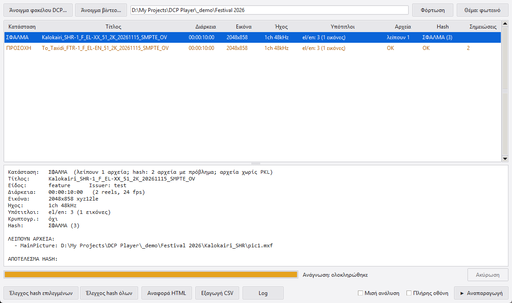
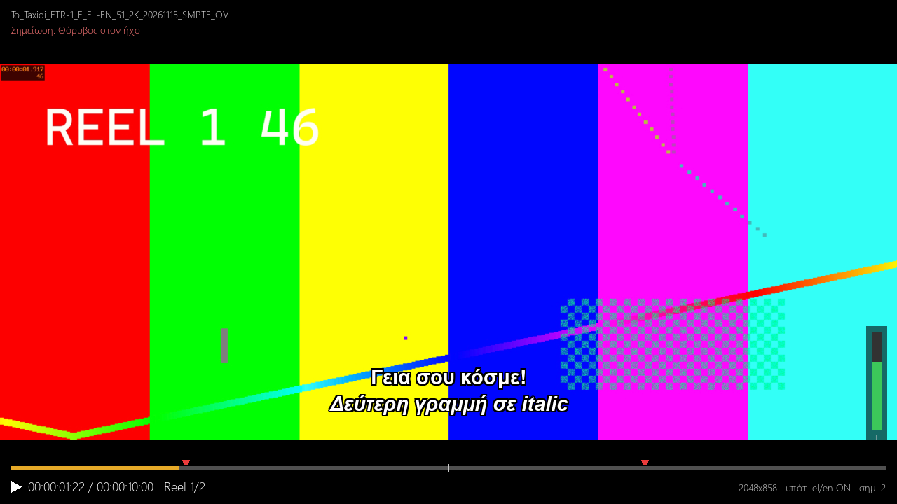
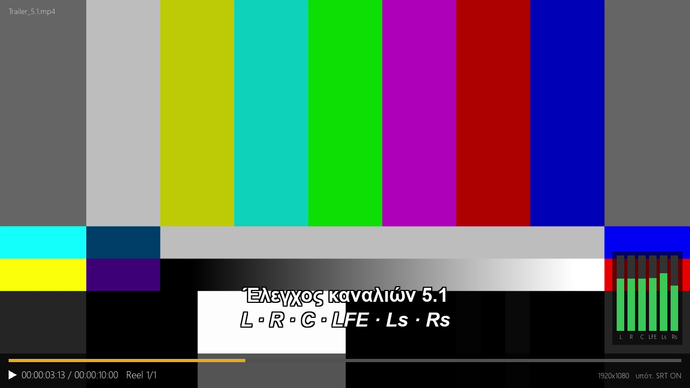

# ReelCheck

Απλός, ερασιτεχνικός player για **έλεγχο DCP ταινιών** (Digital Cinema Package) σε κανονικό PC με Windows.
Φτιάχτηκε για να ελέγχουμε τις ταινίες που στέλνουν στο φεστιβάλ: παίζουν σωστά, έχουν όλα τα αρχεία,
δεν χάλασαν στη μεταφορά, έχουν ήχο και υπότιτλους.

> Δεν είναι εργαλείο προβολής σε αίθουσα ούτε color grading. Τα χρώματα είναι προσεγγιστικά (XYZ → RGB).

## Screenshots

| Φωτεινό θέμα | Σκούρο θέμα |
|---|---|
|  |  |

| Αναπαραγωγή με υπότιτλους και σημειώσεις | Υπότιτλος-εικόνα (PNG) |
|---|---|
|  |  |

| Μετρητές καναλιών ήχου 5.1 |
|---|
|  |

*Τα screenshots είναι από δοκιμαστικά DCP με μοτίβο ελέγχου.*

## Δυνατότητες

- **Παραλαβή με ένα κλικ**: συνδέεις τον δίσκο που ήρθε → εύρεση όλων των DCP, αντιγραφή στον φάκελο του φεστιβάλ
  με επαλήθευση, hash, σάρωση, σύγκριση με τον κατάλογο και αναφορά HTML στο τέλος
- **Δίσκοι Linux (ext2 / ext3 / ext4)**: δίσκοι DCP για servers αιθουσών που τα Windows δεν διαβάζουν. Το ReelCheck
  τους διαβάζει **μόνο για ανάγνωση** (χωρίς driver), δείχνει τα DCP και τα αντιγράφει με έλεγχο
- **Πρόγραμμα προβολών**: προβολές ανά μέρα και αίθουσα, λήξη με βάση τη διάρκεια, **συγκρούσεις ώρας**,
  κατάσταση του DCP κάθε προβολής, εκτύπωση (HTML), CSV, **ημερολόγιο .ics** (Outlook / Google Calendar) και
  **φύλλα μηχανικού προβολής** (μία σελίδα ανά μέρα και αίθουσα: μορφή, ήχος, υπότιτλοι, KDM, κουτάκια ελέγχου)
- **Σύγκριση δύο εκδόσεων DCP**: όταν ο διανομέας στείλει νέα έκδοση, δείχνει τι άλλαξε (reels, διάρκεια, εικόνα,
  ήχος, υπότιτλοι). Τα αρχεία συγκρίνονται με το SHA-1 του PKL, χωρίς να ξαναδιαβαστούν
- **Παρακολούθηση φακέλου**: όταν έρθει νέο DCP (κατέβασμα, αντιγραφή), μπαίνει μόνο του στη λίστα, ελέγχεται
  (hash + σάρωση) και βγαίνει ειδοποίηση των Windows με το αποτέλεσμα
- **Αναφορά PDF για την επιτροπή**: εξώφυλλο με πίνακα και μία σελίδα ανά ταινία με τρία καρέ, στοιχεία,
  ευρήματα, σημειώσεις και χώρο για σχόλια (με τον Edge, που υπάρχει σε κάθε Windows)
- **Συγχρονισμός ήχου-εικόνας**: βρίσκει φλας στην εικόνα και «μπιπ» στον ήχο (sync test, 2-pop, κλακέτα) και
  λέει πόσα ms είναι μπροστά ή πίσω ο ήχος
- **Ident / intro φεστιβάλ**: λογότυπο + μουσική + κείμενο → DCP έτοιμο να μπει πριν από κάθε ταινία
- **Επιστροφές DCP**: ποιοι δίσκοι / DCP επιστρέφονται, σε ποιον και μέχρι πότε, με σήμανση «επιστράφηκε»,
  εκπρόθεσμα με κόκκινο και εξαγωγή CSV
- **Στατιστικά φεστιβάλ**: ταινίες, ώρες, GB, είδος, 2K/4K, ήχος, πρότυπο, υπότιτλοι, κρυπτογραφημένα, κατάσταση
- **Ειδοποιήσεις των Windows** όταν τελειώνει μια μεγάλη εργασία (αντιγραφή, σάρωση, μετατροπή)
- **Ευρήματα που ανοίγουν την αναπαραγωγή**: κλικ σε χρόνο (π.χ. «μαύρη εικόνα 00:10:04») στις λεπτομέρειες
  ανοίγει τον player λίγο πριν από εκείνο το σημείο
- **Ένταση σε LUFS (EBU R128)**: integrated, LRA και true peak στη σάρωση, ζωντανά στον player, και στην
  εξίσωση έντασης της μετατροπής σε DCP
- **Εργαλεία υποτίτλων**: έλεγχος .srt (επικαλύψεις, πολύ σύντομοι / μεγάλοι, ταχύτητα ανάγνωσης, μακριές γραμμές,
  μετά το τέλος), μετατόπιση χρόνου, αλλαγή fps (π.χ. 25 → 24), και οι ίδιοι έλεγχοι στους υπότιτλους των DCP
- **Αγγλικό περιβάλλον** (Ρυθμίσεις → Γενικά → Γλώσσα / Language)
- **Ρυθμίσεις** σε ένα σημείο: γλώσσα, θέμα, φάκελοι, συσκευή ήχου, αρχική ένταση, όρια σάρωσης και υποτίτλων,
  στόχος έντασης LUFS, προδιαγραφές φεστιβάλ, καθαρισμός cache, εξαγωγή / εισαγωγή ρυθμίσεων
- **Αναπαραγωγή DCP** (Interop και SMPTE, JPEG2000, 2K/4K, 24/25/30/48 fps), με συγχρονισμένο ήχο
- **Υπότιτλοι**: κειμένου (Interop XML, SMPTE MXF), εικόνας (PNG), closed captions, και αλλαγή γλώσσας
  από άλλο CPL του ίδιου φακέλου (VF)
- **Έλεγχος ακεραιότητας (hash)**: σύγκριση κάθε αρχείου με το PKL (μέγεθος + SHA-1)
- **Μαζικός έλεγχος**: δίνεις φάκελο με πολλά DCP και βλέπεις όλα τα CPL σε πίνακα με κατάσταση OK / ΠΡΟΣΟΧΗ / ΣΦΑΛΜΑ
- **VF με OV**: ένα Version File (π.χ. μόνο υπότιτλοι) που παίρνει εικόνα και ήχο από το OV του βρίσκει μόνο του
  τα αρχεία στο OV του ίδιου φακέλου («Αρχεία: OK (+OV)»), παίζει κανονικά και ελέγχεται με το PKL του OV
- **Αναφορά HTML** (με καρέ από κάθε ταινία, hash και σημειώσεις, εκτυπώνεται και σε PDF) και **CSV για Excel**
- **Κανάλια ήχου**: μετρητές στάθμης ανά κανάλι και solo σε L / R / C / LFE / Ls / Rs ...
  Οι μετρητές μπορούν να φαίνονται μόνο με τα χειριστήρια, πάντα ή καθόλου (πλήκτρο `A`)
- **Βίντεο → DCP**: πολλά MP4 / MOV / MKV μαζί, είτε **ένα DCP με όλα στη σειρά** (σαν μία ταινία, ένα reel
  ανά βίντεο, κενό ανάμεσα) είτε **ξεχωριστό DCP για κάθε αρχείο**. Υπότιτλοι .srt ίδιου ονόματος μπαίνουν μόνοι
  τους, η ένταση εξισώνεται, και στο τέλος τα DCP ελέγχονται αυτόματα (hash + σάρωση). Χρειάζεται το δωρεάν
  [DCP-o-matic](https://dcpomatic.com), που το ReelCheck βρίσκει και εγκαθιστά μόνο του
- **Μετατροπή βίντεο**: π.χ. MOV → MP4 H.264 / H.265 ή → MOV ProRes, πολλά αρχεία μαζί. Αν το βίντεο είναι ήδη
  H.264/H.265, αλλάζει μόνο το κοντέινερ (σε δευτερόλεπτα, χωρίς απώλεια). Κάρτα γραφικών (NVIDIA / AMD / Intel)
  όταν υπάρχει, αλλαγή ανάλυσης, σωστή περιστροφή βίντεο κινητού, υπότιτλοι .srt δίπλα ή «καμένοι» στην εικόνα.
  Δεν χρειάζεται ξεχωριστό FFmpeg: είναι ήδη μέσα στο ReelCheck
- **DCP → MP4 (screener)**: για επιτροπή ή site, με τους υπότιτλους του DCP στην εικόνα και ήχο σε στέρεο ή 5.1
- **Έλεγχος του ονόματος (DCNC)**: διαβάζει από το όνομα του DCP είδος, γλώσσα ήχου/υποτίτλων, ήχο (5.1, 7.1),
  2K/4K, aspect, fps, SMPTE/Interop, OV/VF, και δείχνει όταν το όνομα δεν ταιριάζει με το περιεχόμενο
  (π.χ. γράφει 5.1 αλλά ο ήχος είναι στέρεο, γράφει EN αλλά δεν έχει αγγλικούς υπότιτλους)
- **Προδιαγραφές φεστιβάλ**: ορίζεις μία φορά τι δέχεστε (2K/4K, fps, SMPTE/Interop, ήχος, γλώσσα υποτίτλων,
  μέγιστη διάρκεια, όχι κρυπτογραφημένα / 3D) και ό,τι δεν ταιριάζει παίρνει ΠΡΟΣΟΧΗ
- **Σάρωση ταινίας χωρίς προβολή**: μαύρη εικόνα, σιωπή, κανάλια χωρίς σήμα, clipping, μέγιστη και μέση στάθμη,
  ήχος διαφορετικής διάρκειας από την εικόνα, υπότιτλοι εκτός διάρκειας (περίπου 3 λεπτά για ταινία 2 ωρών)
- **Αλλαγή ήχου** στην αναπαραγωγή (`U`) από άλλο CPL ίδιας διάρκειας (π.χ. VF με άλλη γλώσσα)
- **Λίστα προβολής**: τρέιλερ / σποτ πρώτα και μετά η ταινία, η μία μετά την άλλη
- **Αντιγραφή σε δίσκο με επαλήθευση**: αντιγράφει τα DCP (μαζί με το OV ενός VF) και ξαναδιαβάζει κάθε αρχείο
  (SHA-1 με το PKL ή με το πρωτότυπο), με αναφορά .txt στον προορισμό
- **Κατάλογος φεστιβάλ**: CSV (ή TXT) με τους τίτλους που περιμένετε, και πίνακας με ποιες ήρθαν, ποιες λείπουν
  και ποιες έχουν πρόβλημα
- **KDM**: για κρυπτογραφημένα DCP δείχνει για ποιον server και από πότε έως πότε ισχύει το KDM
  (τα βρίσκει μόνο του στον φάκελο ή με «Φόρτωση KDM»). Δεν αποκρυπτογραφεί
- **Αναβάθμιση με ένα κλικ**: μία φορά την ημέρα ελέγχει το GitHub· αν υπάρχει νέα έκδοση, με «Ναι» την κατεβάζει,
  ελέγχει το αρχείο (μέγεθος, SHA-256), κλείνει μόνο του και ανοίγει η νέα έκδοση
- **Πολλές οθόνες**: θυμάται σε ποια οθόνη και θέση ήταν το παράθυρο, και διάλογοι / αναπαραγωγή ανοίγουν στην ίδια οθόνη
- **Σημειώσεις στον χρόνο** («θόρυβος στο 01:23:45»), με σημάδια στη μπάρα, που μπαίνουν και στην αναφορά
- **Screenshot** καρέ
- **3D**: επιλογή αριστερού ή δεξιού ματιού
- **Κανονικά αρχεία βίντεο** (MP4, MOV, MKV, ...) με υπότιτλους .srt ίδιου ονόματος
- **Φωτεινό / σκούρο θέμα**: αυτόματα από τις ρυθμίσεις των Windows ή χειροκίνητα (Ρυθμίσεις → Γενικά).
  Η αναφορά HTML ακολουθεί το θέμα του browser
- **Logs** για όταν κάτι πάει στραβά

Δεν παίζει **κρυπτογραφημένα DCP** (θέλουν KDM και πιστοποιημένο server).

## Εγκατάσταση / εκτέλεση

### Έτοιμο .exe (χωρίς Python)

Κατέβασε το `ReelCheck.exe` (από τα Releases ή από τον φάκελο `dist/` μετά το build) και τρέξ' το.
Δουλεύει σε Windows 10/11 64-bit χωρίς τίποτα άλλο εγκατεστημένο.

Την πρώτη φορά τα Windows μπορεί να δείξουν «Τα Windows προστάτευσαν τον υπολογιστή σας»
(το .exe δεν είναι ψηφιακά υπογεγραμμένο): **Περισσότερες πληροφορίες → Εκτέλεση οπωσδήποτε**.

### Αναβάθμιση

Από τη v1.3 και μετά το `ReelCheck.exe` αναβαθμίζεται μόνο του:

1. Μία φορά την ημέρα, λίγα δευτερόλεπτα μετά το άνοιγμα, ελέγχει αν υπάρχει νεότερο release στο GitHub.
   Για έλεγχο αμέσως: **Εργαλεία → Έλεγχος για νέα έκδοση / αναβάθμιση**.
2. Αν υπάρχει, ρωτά: **Ναι** = κατέβασμα και αναβάθμιση τώρα, **Όχι** = άνοιγμα της σελίδας με τις αλλαγές,
   **Άκυρο** = αργότερα.
3. Με «Ναι» κατεβάζει το νέο exe (η πρόοδος φαίνεται στη μπάρα κάτω) και ελέγχει μέγεθος και SHA-256.
4. Κλείνει μόνο του (μαζί με τα παράθυρα αναπαραγωγής), βάζει το νέο exe στη θέση του παλιού και το ανοίγει.
   Ρυθμίσεις, σημειώσεις και σαρώσεις μένουν ως έχουν.

Από τη v1.2 ή παλιότερη χρειάζεται μία φορά χειροκίνητο κατέβασμα του exe από τα Releases.
Αν η αναβάθμιση δεν ολοκληρωθεί (π.χ. το exe είναι ανοιχτό από άλλο πρόγραμμα), βγαίνει μήνυμα και η παλιά
έκδοση μένει όπως ήταν. Όταν τρέχει από τον κώδικα, απλώς ενημερώνει για τη νέα έκδοση (αναβάθμιση με `git pull`).

### Από τον κώδικα

Διπλό κλικ στο **`ReelCheck.bat`**. Την πρώτη φορά:

1. βρίσκει Python ή Anaconda, και αν δεν υπάρχει την κατεβάζει (winget ή python.org)
2. φτιάχνει περιβάλλον στο `%LOCALAPPDATA%\ReelCheck\venv` και εγκαθιστά τις βιβλιοθήκες (`requirements.txt`)

Ή χειροκίνητα:

```bash
pip install -r requirements.txt
python reelcheck.py
```

## Χρήση

**Οδηγίες χρήσης σε PDF** (με εικόνες, για όποιον δουλεύει με το πρόγραμμα), στα ελληνικά και στα αγγλικά:
[docs/guide](docs/guide), ή από το πρόγραμμα **Βοήθεια → Οδηγίες - Guide** (`F1`).

Άνοιγμα DCP:

- κουμπί **Άνοιγμα φακέλου DCP…** (μπορεί να είναι φάκελος με πολλά DCP σε υποφακέλους)
- επικόλληση διαδρομής στο πεδίο + Enter
- σύρσιμο του φακέλου (ή ενός αρχείου βίντεο) πάνω στο `ReelCheck.exe`

Από τη γραμμή εντολών:

```bash
python reelcheck.py "D:\Festival\DCPs"
python reelcheck.py --play "D:\Festival\Film\CPL_xxx.xml" --start 600
python reelcheck.py --play ταινία.mp4
```

### Βίντεο → DCP

Κουμπί **Βίντεο → DCP…** (ή Εργαλεία → Μετατροπή βίντεο σε DCP):

1. **Προσθήκη αρχείων / φακέλου** και σειρά με ▲ ▼. Για κάθε αρχείο φαίνονται διάρκεια, fps, ανάλυση, ήχος και
   αν βρέθηκαν υπότιτλοι (`ταινία.srt` ή `ταινία.el.srt` δίπλα στο βίντεο).
2. **Ρυθμίσεις**: ένα DCP με όλα στη σειρά ή ξεχωριστά DCP, τίτλος, είδος (μικρού/μεγάλου μήκους, τρέιλερ…),
   κάδρο Flat 1.85 / Scope 2.39 (ό,τι έχει άλλη αναλογία μπαίνει με μαύρες λωρίδες, χωρίς κόψιμο), fps,
   κενό ανάμεσα (δευτ.), γλώσσα υποτίτλων, ίδια ένταση για όλα, SMPTE ή Interop.
3. **Μετατροπή σε DCP**: τρέχει στο παρασκήνιο με πρόοδο και ακύρωση. Τα DCP γράφονται στον φάκελο εξόδου,
   φορτώνονται στη λίστα και ελέγχονται αυτόματα.

Σημειώσεις:
- Ένα DCP έχει ένα fps: αν τα βίντεο έχουν διαφορετικά, το παράθυρο το λέει πριν ξεκινήσεις.
- Ελληνικοί τίτλοι γράφονται με λατινικούς χαρακτήρες στο όνομα του DCP (Το Ταξίδι → To Taxidi).
- Χρόνος: περίπου όσο η συνολική διάρκεια ή και αρκετές φορές παραπάνω, ανάλογα με τον υπολογιστή.
  Χώρος: περίπου 2× το τελικό DCP όσο τρέχει (τα προσωρινά σβήνονται στο τέλος).
- **DCP-o-matic**: αν δεν είναι εγκατεστημένο, το κουμπί «Κατέβασμα και εγκατάσταση» ανοίγει τη σελίδα του.
  Εκεί πατάς «Windows 64-bit» (η σελίδα προτείνει δωρεά στον δημιουργό, μπορείς να συνεχίσεις και χωρίς).
  Το ReelCheck βλέπει τον installer στις Λήψεις και κάνει μόνο του την εγκατάσταση (τα Windows ζητούν άδεια).
  Πλήρως αυτόματη λήψη δεν γίνεται, γιατί το site δεν δίνει απευθείας link.

### Μετατροπή βίντεο (π.χ. MOV → MP4) και DCP → MP4

Κουμπί **Μετατροπή βίντεο…** (ή Εργαλεία). Για screener από DCP: επίλεξε DCP στη λίστα και
**Εργαλεία → Εξαγωγή επιλεγμένων DCP σε MP4**.

| Ρύθμιση | Επιλογές |
|---|---|
| Σε | MP4 H.264 (παίζει παντού), MP4 H.265 (μικρότερο), MOV ProRes 422 HQ (για μοντάζ) |
| Ποιότητα | Υψηλή / Κανονική / Μικρό αρχείο |
| Ανάλυση | Ίδια / 4K / 1080p / 720p (ποτέ μεγέθυνση) |
| Ήχος | Στέρεο / ίδια κανάλια (π.χ. 5.1) |
| Υπότιτλοι .srt | χωρίς / αντιγραφή δίπλα στο νέο αρχείο / «καμένοι» στην εικόνα |
| Κάρτα γραφικών | NVIDIA, AMD ή Intel, αν υπάρχει και δουλεύει (το ReelCheck το δοκιμάζει) |
| Χωρίς επανακωδικοποίηση όταν γίνεται | π.χ. MOV H.264 → MP4: σε δευτερόλεπτα, χωρίς απώλεια ποιότητας |

Τα νέα αρχεία γράφονται στον φάκελο εξόδου ή, αν μείνει κενός, δίπλα στο πρωτότυπο (ποτέ πάνω του).
Για DCP χρειάζεται φάκελος εξόδου· τα χρώματα μετατρέπονται από XYZ σε Rec.709 (προσεγγιστικά).

**Για DCP από MOV δεν χρειάζεται πρώτα MP4**: το «Βίντεο → DCP» δέχεται κατευθείαν MOV/ProRes, και κάθε
ενδιάμεση μετατροπή χάνει λίγη ποιότητα.

### Μενού «Εργαλεία»

| Εντολή | Τι κάνει |
|---|---|
| Παραλαβή DCP από δίσκο… | πηγή → αντιγραφή με επαλήθευση → hash + σάρωση → κατάλογος → αναφορά (και κουμπί «Παραλαβή DCP…») |
| Δίσκος Linux (ext2/3/4)… | βλ. παρακάτω |
| Έλεγχος υποτίτλων .srt… | προβλήματα, μετατόπιση χρόνου, αλλαγή fps, αποθήκευση |
| Σάρωση επιλεγμένων / όλων | μαύρο, σιωπή, κανάλια, clipping, υπότιτλοι (και κουμπί «Σάρωση ταινίας») |
| Συγχρονισμός ήχου-εικόνας επιλεγμένων | φλας + μπιπ στα πρώτα 2 λεπτά (αλλάζει στις Ρυθμίσεις → Έλεγχοι) |
| Σύγκριση δύο επιλεγμένων DCP | Ctrl+κλικ σε δύο ταινίες· πίνακας με ό,τι διαφέρει, εξαγωγή CSV |
| Λίστα προβολής με τα επιλεγμένα | διάλεξε με Ctrl+κλικ τρέιλερ και ταινία· παίζουν με τη σειρά |
| Αντιγραφή επιλεγμένων σε δίσκο με επαλήθευση… | αντιγραφή + έλεγχος SHA-1 κάθε αρχείου |
| Φόρτωση KDM… | πληροφορίες KDM για κρυπτογραφημένα DCP |
| Έλεγχος για νέα έκδοση / αναβάθμιση | ρωτά το GitHub και, αν θες, αναβαθμίζει αμέσως |

### Μενού «Φεστιβάλ»

| Εντολή | Τι κάνει |
|---|---|
| Πρόγραμμα προβολών… | προβολές, συγκρούσεις ώρας, κατάσταση DCP, εκτύπωση, ημερολόγιο .ics, φύλλα μηχανικού προβολής |
| Αναφορά PDF για την επιτροπή… | οι επιλεγμένες ταινίες (ή όλες), μία σελίδα η καθεμία |
| Στατιστικά φεστιβάλ | σύνοψη της λίστας, εξαγωγή CSV |
| Κατάλογος φεστιβάλ (CSV)… | ποιες ταινίες του καταλόγου ήρθαν και σε τι κατάσταση |
| Επιστροφές DCP… / Προσθήκη επιλεγμένων… | λίστα επιστροφών με προθεσμίες |
| Ident / intro φεστιβάλ → DCP… | λογότυπο, μουσική, κείμενο, διάρκεια → DCP (με το DCP-o-matic) |
| Παρακολούθηση φακέλου για νέα DCP… | ανοίγει τις Ρυθμίσεις → Φάκελοι, όπου ενεργοποιείται |

Ο κατάλογος είναι CSV με στήλη «Τίτλος» (ή «Title», «Ταινία»), με `;` ή `,`, ή απλό TXT με έναν τίτλο ανά
γραμμή. Οι ελληνικοί τίτλοι συγκρίνονται και με λατινικούς χαρακτήρες (Το Ταξίδι → TOTAXIDI).

### Ρυθμίσεις

Μενού **Ρυθμίσεις → Ρυθμίσεις…** (ή κατευθείαν «Προδιαγραφές φεστιβάλ…», «Φάκελοι…», «Αναπαραγωγή…»).
Κάθε ρύθμιση υπάρχει μόνο εδώ. Οι αλλαγές ισχύουν αμέσως, εκτός από τη γλώσσα, που θέλει επανεκκίνηση.

| Καρτέλα | Ρυθμίσεις |
|---|---|
| Γενικά | γλώσσα (ελληνικά / English), θέμα, αυτόματος έλεγχος νέας έκδοσης, άνοιγμα στον τελευταίο φάκελο |
| Φάκελοι | φάκελος του φεστιβάλ (παραλαβές), έξοδος «Βίντεο → DCP», έξοδος «Μετατροπή βίντεο», screenshots |
| Αναπαραγωγή | πλήρης οθόνη / μισή ανάλυση στην αρχή, συσκευή ήχου, αρχική ένταση, υπότιτλοι, μετρητές ήχου, πόσα δευτ. πριν από ένα εύρημα |
| Έλεγχοι | από πόσα δευτ. μαύρο / σιωπή γίνεται εύρημα, λεπτά τίτλων αρχής / τέλους, όρια υποτίτλων, στόχος έντασης LUFS με ανοχή |
| Φεστιβάλ | προδιαγραφές φεστιβάλ (ανάλυση, fps, πρότυπο, ήχος, γλώσσα υποτίτλων, διάρκεια, κρυπτογράφηση, 3D) |
| Δεδομένα | άνοιγμα φακέλου δεδομένων, καθαρισμός cache hash και σαρώσεων, εξαγωγή / εισαγωγή ρυθμίσεων |

Αν η συσκευή ήχου που επιλέχθηκε δεν είναι συνδεδεμένη, ο ήχος παίζει από την προεπιλεγμένη των Windows.
Με την εξαγωγή / εισαγωγή οι ρυθμίσεις περνούν σε άλλον υπολογιστή (π.χ. προδιαγραφές του φεστιβάλ).

### Δίσκοι Linux (ext2 / ext3 / ext4)

Πολλά DCP έρχονται σε δίσκους για servers αιθουσών, που τα Windows δεν διαβάζουν.

> **Όταν τα Windows ρωτήσουν «Πρέπει να διαμορφώσετε τον δίσκο», πάτα ΑΚΥΡΟ.** Η διαμόρφωση σβήνει τα DCP.

Εργαλεία → **Δίσκος Linux…**: δείχνει τα partitions Linux των συνδεδεμένων δίσκων. Για να διαβαστεί φυσικός δίσκος
τα Windows θέλουν δικαιώματα διαχειριστή: το κουμπί «Άνοιγμα του ReelCheck ως διαχειριστής» ανοίγει νέο ReelCheck
(με ερώτηση UAC) κατευθείαν σε αυτό το παράθυρο. Μετά: «Ανάγνωση επιλεγμένου» → λίστα DCP → «Αντιγραφή και έλεγχος».
Ο δίσκος ανοίγει **μόνο για ανάγνωση**· το ReelCheck δεν γράφει ποτέ σε αυτόν. Δέχεται και αρχεία εικόνας δίσκου (.img).

Υποστηρίζονται ext2, ext3 και ext4 (block maps και extents, 32/64 bit, πίνακες MBR και GPT). Το WSL των Windows
δεν χρησιμοποιείται, γιατί δεν ανοίγει δίσκους USB.

### Πλήκτρα στην αναπαραγωγή

| Πλήκτρο | Λειτουργία |
|---|---|
| `Space` | παύση / συνέχεια |
| `←` `→` | -10 / +10 δευτ. (`Shift`: ±60) |
| `,` `.` | καρέ-καρέ |
| `PgUp` `PgDn` | προηγούμενο / επόμενο reel |
| `Home` | αρχή |
| `F` | πλήρης οθόνη |
| `H` | μισή / πλήρης ανάλυση (για αργά PC) |
| `S` | υπότιτλοι on/off |
| `L` | αλλαγή υποτίτλων (γλώσσα / CC) |
| `U` | αλλαγή ήχου (από άλλο CPL ίδιας διάρκειας) |
| `0` | ήχος: όλα τα κανάλια |
| `1`–`9` | ήχος: solo καναλιού |
| `A` | μετρητές ήχου: αυτόματα (με τα χειριστήρια) → πάντα → κρυφοί |
| `M` | σίγαση |
| `N` | νέα σημείωση στον τρέχοντα χρόνο |
| `J` / `Shift+J` | επόμενη / προηγούμενη σημείωση |
| `Ctrl+Z` | σβήσιμο τελευταίας σημείωσης |
| `[` `]` | επανάληψη A–B: αρχή / τέλος (`\` ακύρωση) |
| `Z` | zoom 2x στο σημείο του ποντικιού (ξανά `Z` για κανονικό) |
| `P` | screenshot (στο `Εικόνες\ReelCheck`) |
| `E` | 3D: αριστερό / δεξί μάτι |
| `Esc` / `Q` | έξοδος |
| κλικ στη μπάρα | μετάβαση |

## Αρχεία που γράφει

| Τι | Πού |
|---|---|
| Log | `%APPDATA%\ReelCheck\reelcheck.log` (κουμπί **Log**) |
| Σημειώσεις | `%APPDATA%\ReelCheck\notes\<CPL id>.json` |
| Cache των hash | `%APPDATA%\ReelCheck\hash_cache.json` |
| Ρυθμίσεις (όλες, και θέση παραθύρου) | `%APPDATA%\ReelCheck\settings.json` |
| Λήψη νέας έκδοσης (προσωρινά) | `%TEMP%\ReelCheck_update\` |
| Αποτελέσματα σάρωσης | `%APPDATA%\ReelCheck\scans\<CPL id>.json` |
| Πρόγραμμα προβολών / επιστροφές | `%APPDATA%\ReelCheck\schedule.json`, `returns.json` |
| Αναφορά αντιγραφής | στον φάκελο προορισμού (`ReelCheck_αντιγραφή_….txt`) |
| Screenshots | `%USERPROFILE%\Pictures\ReelCheck\` |

Στον φάκελο του DCP δεν γράφεται τίποτα.

Ο έλεγχος για νέα έκδοση ρωτά μόνο το δημόσιο API του GitHub (`api.github.com`) και δεν στέλνει τίποτα για
τον χρήστη ή τις ταινίες.

## Δομή κώδικα

```
reelcheck.py          είσοδος προγράμματος (γραμμή εντολών, --play, selftest)
app/
  core/               χωρίς γραφικά, ξαναχρησιμοποιείται παντού
    config.py         ρυθμίσεις, διαδρομές, logging, assets
    util.py           κοινά βοηθητικά: χρόνος/μέγεθος, XML, κείμενο UTF-8/cp1253, CSV για Excel,
                      SHA-1 αρχείου, «είναι DCP;», ελληνικά → λατινικά, Ακύρωση (Cancelled)
    avio.py           κοινός ήχος/εικόνα με PyAV: ήχος / καρέ reel, καρέ σε χρόνο, αρίθμηση καρέ, seek
    dcp.py            ASSETMAP, CPL, PKL, VF που παίρνουν αρχεία από OV, αρχεία βίντεο
    subtitles.py      υπότιτλοι Interop / SMPTE / PNG / SRT
    media.py          ανάλυση εικόνας/ήχου, καρέ (thumbnail)
    hashing.py        έλεγχος SHA-1 με το PKL (με cache)
    notes.py          σημειώσεις στον χρόνο
    related.py        CPL ίδιας διάρκειας, εναλλακτικός ήχος
    report.py         κατάσταση, CSV, αναφορά HTML
    i18n.py, lang_en.py  γλώσσα: μετάφραση στα αγγλικά την ώρα που εμφανίζεται ένα κείμενο
    prefs.py          όλες οι ρυθμίσεις με τις προεπιλογές τους
  checks/             έλεγχοι που δίνουν ευρήματα (err / warn / info)
    dcnc.py           όνομα DCNC και σύγκριση με το περιεχόμενο
    spec.py           προδιαγραφές φεστιβάλ
    scan.py           σάρωση εικόνας / ήχου / υποτίτλων
    kdm.py            ανάγνωση KDM
    langs.py          κωδικοί γλωσσών
    loudness.py       ένταση LUFS (EBU R128)
    issues.py         όλα τα ευρήματα μιας ταινίας
    sync.py           συγχρονισμός ήχου-εικόνας (φλας + μπιπ)
  tools/
    copier.py         αντιγραφή με επαλήθευση
    ingest.py         παραλαβή DCP από δίσκο
    extfs.py          ανάγνωση ext2/ext3/ext4 (μόνο ανάγνωση)
    schedule.py       πρόγραμμα προβολών
    subcheck.py       έλεγχος και διόρθωση υποτίτλων
    convert.py        βίντεο → DCP (σειρά, κενά, ένταση, ένα ή πολλά DCP)
    dcpomatic.py      εύρεση / εγκατάσταση DCP-o-matic, project, κωδικοποίηση
    mediainfo.py      στοιχεία βίντεο, στάθμη ήχου, .srt δίπλα στο βίντεο
    transcode.py      μετατροπή βίντεο (PyAV/FFmpeg), DCP → MP4, υπότιτλοι στην εικόνα
    catalog.py        κατάλογος φεστιβάλ
    playlist.py       σειρά λίστας προβολής
    update.py         έλεγχος νέας έκδοσης
    compare.py        σύγκριση δύο εκδόσεων DCP
    watch.py          παρακολούθηση φακέλου για νέα DCP
    returns.py        λίστα επιστροφών
    stats.py          στατιστικά φεστιβάλ
    ident.py          ident φεστιβάλ (λογότυπο + μουσική → βίντεο)
    pdf.py            HTML → PDF με τον Edge / Chrome
  player/             αναπαραγωγή (pygame + PyAV/FFmpeg + sounddevice)
    window.py         PlayerWindow: πλήκτρα, βρόχος, σχεδίαση
    playback.py       αποκωδικοποίηση εικόνας/ήχου σε threads
    audio.py          έξοδος ήχου, downmix
    osd.py            μπάρα χρόνου, μετρητές, μηνύματα
    subs_render.py    σχεδίαση υποτίτλων
  ui/                 παράθυρο επιλογής (tkinter)
    launcher.py       LauncherWindow: λίστα, λεπτομέρειες, έλεγχοι, αναπαραγωγή
    launcher_tools.py εργαλεία του μενού (μετατροπές, παραλαβή, αντιγραφή, κατάλογος, ρυθμίσεις)
    launcher_update.py έλεγχος νέας έκδοσης και αναβάθμιση
    launcher_festival.py σύγκριση, παρακολούθηση φακέλου, PDF επιτροπής, στατιστικά, επιστροφές, sync, ident
    returns_window.py, ident_window.py   παράθυρα «Επιστροφές DCP» και «Ident φεστιβάλ»
    notify.py         ειδοποιήσεις των Windows
    widgets.py        κοινά κομμάτια παραθύρων: πίνακας, λίστα επιλογής, επιλογή φακέλου
    dialogs.py        προδιαγραφές φεστιβάλ, κατάλογος
    convert_window.py παράθυρο «Βίντεο → DCP»
    ingest_window.py, linux_disk_window.py, schedule_window.py, subtitle_window.py
    i18n_tk.py        σύνδεση της μετάφρασης με τα παράθυρα
    settings_window.py παράθυρο «Ρυθμίσεις»
    transcode_window.py παράθυρο «Μετατροπή βίντεο»
    jobs.py           εργασίες στο παρασκήνιο με πρόοδο / ακύρωση
    spawn.py          εκκίνηση του player
    theme.py          φωτεινό / σκούρο θέμα
    winutil.py        θέμα και μπάρα τίτλου των Windows
assets/               icon.ico, icon.png
docs/guide/           οδηγίες χρήσης: ReelCheck_Guide.pdf / _EN.pdf, κείμενο guide.html / guide_en.html, guide.css
scripts/make_guide.py οδηγίες → PDF (με τον Edge)
scripts/guide_shots.py screenshots για τις οδηγίες: el → guide-*.png, en → guide-en-*.png
scripts/make_icon.py  δημιουργία των εικονιδίων
ReelCheck.bat         εκκίνηση από τον κώδικα με αυτόματη εγκατάσταση
build_exe.bat         χτίσιμο του dist\ReelCheck.exe με PyInstaller
```

Το `core/` δεν εξαρτάται από γραφικά, οπότε οι συναρτήσεις του (π.χ. `load_dcp`, `verify_cpl`, `scan_cpl`)
μπορούν να χρησιμοποιηθούν και από άλλα scripts:

```python
from app.core.dcp import load_dcp
from app.checks.scan import scan_cpl

for cpl in load_dcp(r"D:\Festival\Film"):
    print(cpl.title, scan_cpl(cpl)["peak_db"])
```

### Χτίσιμο του .exe

```bash
build_exe.bat
```

Χρειάζεται πρώτα να έχει τρέξει μία φορά το `ReelCheck.bat` (για το περιβάλλον). Αν η Python είναι της
Anaconda, το script προσθέτει μόνο του τα DLL που λείπουν (expat, Tcl/Tk κ.λπ.).

### Τεστ και αυτόματο build στο GitHub

```bash
python -m unittest discover -s tests -t . -v
```

Τα τεστ (`tests/`) ελέγχουν ανάγνωση DCP και VF/OV, ονόματα DCNC, κατάλογο, αναβάθμιση, σάρωση, LUFS, υπότιτλους,
πρόγραμμα προβολών, ext2/ext4, μετάφραση και πραγματική μετατροπή μικρών βίντεο.

Στο GitHub (`.github/workflows/build.yml`), σε κάθε push τρέχουν τα τεστ, χτίζεται το exe και ελέγχεται με τον
αυτοέλεγχό του. Σε κάθε release ανεβαίνει αυτόματα στο release το exe που χτίστηκε εκεί.

### Μεταβλητές για δοκιμές

| Μεταβλητή | Αποτέλεσμα |
|---|---|
| `DCP_SELFTEST=αρχείο.txt` | ελέγχει ότι φορτώνουν όλες οι βιβλιοθήκες και γράφει το αποτέλεσμα |
| `DCP_SNAPSHOT=αρχείο.png` | ο player σώζει το πρώτο καρέ και κλείνει |
| `DCP_LAUNCHER_SHOT=αρχείο.png` | το παράθυρο επιλογής σώζει screenshot και κλείνει |
| `DCP_THEME=light` / `dark` | επιβάλλει θέμα (π.χ. για screenshots) |
| `DCP_SHOT_HASH=1` | μαζί με το `DCP_LAUNCHER_SHOT`: τρέχει πρώτα τον έλεγχο hash |
| `DCP_SNAPSHOT_DELAY=1.5` | μαζί με το `DCP_SNAPSHOT`: δευτερόλεπτα πριν σωθεί το καρέ |

## Αλλαγές

### v1.10
- **Οδηγίες χρήσης σε PDF** (20 σελίδες, με εικόνες) στο [docs/guide](docs/guide).
- Νέο μενού **Βοήθεια**: «Πληροφορίες» και «Οδηγίες - Guide» (ή `F1`), που ανοίγει τις οδηγίες στο GitHub.

### v1.9
- Νέο μενού **Φεστιβάλ**: πρόγραμμα προβολών με **ημερολόγιο .ics** και **φύλλα μηχανικού προβολής**,
  **αναφορά PDF για την επιτροπή**, **στατιστικά**, κατάλογος, **επιστροφές DCP**, **ident φεστιβάλ → DCP**.
- **Σύγκριση δύο εκδόσεων DCP** (με το SHA-1 του PKL, χωρίς να ξαναδιαβαστούν τα αρχεία).
- **Παρακολούθηση φακέλου**: νέο DCP μπαίνει στη λίστα και ελέγχεται μόνο του.
- **Συγχρονισμός ήχου-εικόνας** από sync test / 2-pop / κλακέτα, σε ms.
- **Ειδοποιήσεις των Windows** όταν τελειώνει μεγάλη εργασία.

### v1.8
- Καθαρισμός κώδικα: ό,τι γινόταν σε πολλά σημεία έγινε μία κοινή συνάρτηση (ήχος και καρέ από DCP, κείμενο
  με ελληνική κωδικοποίηση, CSV για Excel, SHA-1, μεταγραφή ελληνικών, πίνακες και επιλογή φακέλου στα παράθυρα).
- Οι μεγάλες συναρτήσεις (μετατροπή βίντεο, DCP → MP4, αντιγραφή, σάρωση, υπότιτλοι, CPL, αναπαραγωγή) χωρίστηκαν
  σε μικρότερες· το κεντρικό παράθυρο σε τρία αρχεία. Καμία αλλαγή στη λειτουργία.
- Οι φάκελοι εξόδου των παραθύρων διαβάζονται από τις Ρυθμίσεις (αγνοείται φάκελος που δεν υπάρχει πια).

### v1.7
- Νέο μενού **Ρυθμίσεις** με καρτέλες: Γενικά, Φάκελοι, Αναπαραγωγή, Έλεγχοι, Φεστιβάλ, Δεδομένα.
- Γλώσσα ελληνικά / English, θέμα, συσκευή ήχου και αρχική ένταση, όρια σάρωσης και υποτίτλων, στόχος LUFS,
  καθαρισμός cache, εξαγωγή / εισαγωγή ρυθμίσεων.
- Το κουμπί «Θέμα» και το «Γλώσσα» των Εργαλείων μεταφέρθηκαν στις Ρυθμίσεις.

### v1.6
- Παραλαβή DCP με ένα κλικ (αντιγραφή με επαλήθευση, έλεγχοι, κατάλογος, αναφορά).
- Δίσκοι Linux ext2/ext3/ext4: ανάγνωση και αντιγραφή χωρίς driver, μόνο για ανάγνωση.
- Πρόγραμμα προβολών με συγκρούσεις ώρας και κατάσταση DCP.
- Ευρήματα και σημειώσεις με κλικ ανοίγουν τον player σε εκείνο το σημείο.
- Ένταση LUFS (EBU R128) στη σάρωση, ζωντανά στον player και στην εξίσωση έντασης.
- Εργαλεία υποτίτλων: έλεγχος, μετατόπιση χρόνου, αλλαγή fps.
- Player: επανάληψη A–B (`[` `]` `\`), zoom 2x (`Z`).
- Αγγλικό περιβάλλον.
- Αυτόματα τεστ και build στο GitHub.

### v1.5
- Μετατροπή βίντεο (MOV → MP4 H.264/H.265, ProRes) με το FFmpeg που περιέχει ήδη το ReelCheck: χωρίς
  επανακωδικοποίηση όταν γίνεται, κάρτα γραφικών, αλλαγή ανάλυσης, περιστροφή βίντεο κινητού, υπότιτλοι.
- DCP → MP4 (screener) με τους υπότιτλους του DCP στην εικόνα.

### v1.4
- Μετατροπή βίντεο σε DCP με το DCP-o-matic: πολλά αρχεία σε ένα DCP (ένα reel ανά βίντεο, κενό ανάμεσα) ή
  ξεχωριστά DCP, υπότιτλοι .srt, εξίσωση έντασης, αυτόματος έλεγχος στο τέλος.
- Εύρεση και εγκατάσταση του DCP-o-matic από το ReelCheck.

### v1.3.1
- Το παράθυρο θυμάται σωστά οθόνη, θέση και μεγιστοποίηση (πριν, μεγιστοποιημένο δεν αποθηκευόταν).
- Δεν μικραίνει πια κατά 20 pixel σε κάθε άνοιγμα/κλείσιμο.

### v1.3
- Έλεγχος ονόματος DCNC, προδιαγραφές φεστιβάλ, σάρωση ταινίας χωρίς προβολή.
- Αλλαγή ήχου από άλλο CPL (`U`), λίστα προβολής, αντιγραφή με επαλήθευση, κατάλογος φεστιβάλ,
  πληροφορίες KDM.
- Αναβάθμιση με ένα κλικ από τα επόμενα releases (κλείνει και ανοίγει μόνο του).
- Διάλογοι και αναπαραγωγή ανοίγουν στην οθόνη όπου είναι το παράθυρο· θυμάται θέση και οθόνη.
- Ο κώδικας οργανώθηκε σε φακέλους (`app/core`, `checks`, `tools`, `player`, `ui`, `assets`) και κλάσεις
  (`LauncherWindow`, `PlayerWindow`) με μικρότερες συναρτήσεις.

### v1.2
- VF που παίρνουν εικόνα και ήχο από OV: δεν βγαίνει πια ψεύτικο «λείπουν αρχεία». Τα αρχεία βρίσκονται στο OV
  του ίδιου φακέλου και το hash ελέγχεται με το PKL του OV.
- Τα `MainMarkers` και `CompositionMetadataAsset` δεν μετριούνται πια ως αρχεία που λείπουν (υπάρχουν μόνο μέσα στο CPL).
- Μετρητές ήχου: το `A` εναλλάσσει αυτόματα (με τα χειριστήρια) → πάντα → κρυφοί.

### v1.1
- Πρώτη δημόσια έκδοση.

## Γνωστοί περιορισμοί

- Κρυπτογραφημένα DCP: δεν παίζουν (θέλουν KDM).
- Τα 4K παίζουν αυτόματα σε μισή ανάλυση για να προλαβαίνει η αποκωδικοποίηση.
- Ο ήχος 5.1 και άνω γίνεται downmix σε στέρεο (ή solo καναλιού).
- 3D και υπότιτλοι-εικόνες σε SMPTE MXF δεν έχουν δοκιμαστεί με πραγματικά DCP.
- Οι χρόνοι των υποτίτλων SMPTE με `StartTime` διαφορετικό από 0 αγνοούν το `StartTime`.
- Η σάρωση ελέγχει την εικόνα με δείγμα κάθε 2,5 δευτ. περίπου: πολύ σύντομα μαύρα κενά μπορεί να μη φανούν.
  Μαύρο ή σιωπή είναι συχνά σκηνοθετική επιλογή· τα ευρήματα είναι σημεία για έλεγχο, όχι σίγουρα λάθη.
- Η ένταση είναι LUFS (EBU R128), όχι Leq(m) του κινηματογράφου.
- Οι δίσκοι Linux δοκιμάστηκαν με εικόνες ext2/ext3/ext4 (MBR, GPT) φτιαγμένες με `mke2fs`, όχι ακόμα με πραγματικό
  φυσικό δίσκο DCP. Δεν υποστηρίζονται δίσκοι με κρυπτογράφηση ή LVM.
- Το αγγλικό περιβάλλον μεταφράζει όσα κείμενα είναι στο λεξικό (`app/core/lang_en.py`)· κάποιο σπάνιο μήνυμα μπορεί
  να μείνει στα ελληνικά.
- Η επαλήθευση μετά την αντιγραφή διαβάζει ξανά τα αρχεία· για μικρά αρχεία τα Windows μπορεί να τα δώσουν
  από τη μνήμη αντί για τον δίσκο.

## Βιβλιοθήκες

[PyAV](https://github.com/PyAV-Org/PyAV) (FFmpeg), [pygame-ce](https://github.com/pygame-community/pygame-ce),
[sounddevice](https://github.com/spatialaudio/python-sounddevice), [NumPy](https://numpy.org/),
[Pillow](https://python-pillow.org/), [PyInstaller](https://pyinstaller.org/).
